# Arranjaments de cambra amb OpenCode

Un ajudant per a professors i professores de música que volen fer arranjaments de cambra (per exemple, passar un coral a quartet de metalls) sense saber programar. Li parles en valencià, com a una persona, i ell s'encarrega de les gestions: buscar la partitura, transportar, comprovar que cada instrument pot tocar el que li toca i generar els PDF.

Una cosa important: la intel·ligència artificial NO escriu les notes. Tot el treball musical el fan unes eines normals, provades i previsibles. L'ajudant només tria quina eina toca i t'explica el resultat. Així, si el model gratuït que fas servir un dia és poc llest, no et fa malbé la música.

## Instal·lació: baixa un fitxer i fes-hi doble clic

És **un sol fitxer per ordinador**: no cal descomprimir ni desbloquejar res. Tria el teu:

| Ordinador | Baixa | Què fer després |
| --- | --- | --- |
| **Windows** (10 i 11; Intel, AMD o ARM) | **[Arranjaments-Windows.exe](https://github.com/Carlescamarasa/arranjaments/releases/latest/download/Arranjaments-Windows.exe)** | Doble clic al fitxer. |
| **Mac** (Apple Silicon o Intel) | **[Arranjaments-Mac.dmg](https://github.com/Carlescamarasa/arranjaments/releases/latest/download/Arranjaments-Mac.dmg)** | Doble clic al DMG i, a la finestra que s'obri, doble clic a «Instal·lar Arranjaments». |
| **LliureX** i altres Linux (Intel, AMD o ARM) | **[Arranjaments-LliureX.run](https://github.com/Carlescamarasa/arranjaments/releases/latest/download/Arranjaments-LliureX.run)** | Dona-li permís d'execució i doble clic. Els detalls, [més avall](#linux). |

Requisits del Mac: macOS 13 (Ventura) o posterior, Apple Silicon o Intel.

(No uses el botó verd «Code» d'esta pàgina: aquell ZIP no porta l'instal·lador.)

**Pas 1. Baixa el fitxer del teu ordinador** (taula de dalt). L'ordinador tria sol la versió que li va bé (per exemple, ARM o Intel).

**Pas 2. Obri'l.**

- Windows: fes doble clic a `Arranjaments-Windows.exe` (és el programa «Instal·lar Arranjaments», amb la icona d'un pentagrama).
- Mac: fes doble clic a `Arranjaments-Mac.dmg`. S'obri una finestra amb una sola cosa, l'aplicació `Instal·lar Arranjaments`. Fes-hi doble clic allà mateix, sense arrossegar-la enlloc. Quan acabes, pots expulsar el disc (la fletxa al costat d'«Arranjaments» a la barra lateral del Finder) i esborrar el DMG.
- La primera vegada, el sistema avisa perquè el programa ve d'internet i no està signat per cap empresa. Mira més avall [què cal prémer](#avisos). Si el fitxer t'ha arribat en un llapis USB i no baixat d'internet, potser no apareix cap avís.

S'obri una finestra amb la llista del que s'instal·larà. Prem **«Instal·lar»**. Cada pas es marca quan acaba: les eines musicals, l'aplicació OpenCode, MuseScore, la teua carpeta de treball i la icona de l'Escriptori. Pot tardar uns minuts la primera vegada. Quan acaba diu **«Tot a punt»**. A «Veure detalls» pots llegir tot el que ha fet.

Què t'ha deixat a l'ordinador:

- Una carpeta **`Arranjaments` dins de Documents**, amb dues carpetes: `entrada` (on poses els teus PDF o MusicXML) i `eixida` (on apareixen les partitures que crees). És l'única cosa que has de tocar.
- Una icona **«Arranjaments»** a l'Escriptori, per a obrir l'ajudant.
- Les eines musicals, guardades dins de l'ordinador com les de qualsevol aplicació. No cal que les busques.

**Actualitzacions.** Cada vegada que obris la icona «Arranjaments», el programa busca sol si n'hi ha una versió nova i, si n'hi ha, l'instal·la en silenci, sense preguntar res i sense que es note (si no hi ha internet, obri OpenCode com sempre). Les teues partitures no es toquen. Si una novetat va malament, a l'ajudant li pots dir «torna a la versió anterior» (o, al Terminal, `partitures actualitzar --torna-enrere`). Per a saber què hi ha de nou, pregunta-li a l'ajudant «què hi ha de nou?». **Si vas instal·lar abans del 19 de novembre de 2026, torna a fer l'instal·lació una vegada** (baixa el fitxer del teu ordinador i obri'l): la icona antiga no sap actualitzar-se.

Si tornes a obrir «Instal·lar Arranjaments» (per exemple, amb un fitxer més nou), actualitza les eines i fa el que falte. **Les partitures d'`entrada` i `eixida` no les toca mai.**

- Mac: no demana contrasenya. Les aplicacions van a la carpeta Aplicacions de la teua usuària (`~/Applications`). Si el Mac pregunta si «Instal·lar Arranjaments» pot accedir a l'Escriptori o a Documents, prem «Permet»: és per a deixar la icona a l'Escriptori i crear la carpeta de treball a Documents.
- Windows: OpenCode s'instal·la sense permisos especials, però **MuseScore demana permís d'administrador** (finestra blava, prem «Sí»), perquè s'instal·la per a tots els usuaris de l'ordinador. En un Windows ARM, OpenCode s'instal·la en la versió ARM i MuseScore en la x64, que Windows 11 fa funcionar sol. Si la finestra blava no apareix, mira si parpelleja una icona a la barra de tasques i prem-la. Si l'ordinador és de la feina o del centre i no et deixa, consulta-ho amb qui l'administra.
- Si alguna cosa no es pot instal·lar sola, la finestra t'ho diu i té un botó amb els passos per a fer-ho a mà.

**Pas 3. Fes doble clic a la icona «Arranjaments» de l'Escriptori.** S'obri OpenCode. **La primera vegada**, obri la teua carpeta de treball: botó «Afegeix projecte» (en castellà, «Añadir proyecto»; en anglés, «Add project») i selecciona la carpeta **`Arranjaments` de Documents**. Les vegades següents ja apareix a la llista de projectes recents. Després escriu el que vols, per exemple: «Busca'm un coral de Bach». Ja està.

(Ara per ara OpenCode no té cap manera documentada d'obrir-se directament dins d'una carpeta, per això la icona només obri l'aplicació i cal triar la carpeta una vegada.)

L'ajudant et dirà, només quan faça falta, si has d'instal·lar alguna cosa més (per exemple, el programa que llig PDF el dia que en portes un) i t'ho preguntarà abans. Si l'aplicació et demana permís per a fer una cosa que no entens, **digues que no** i pregunta a l'ajudant què volia fer i per què.

Els models gratuïts ja venen preparats: no cal compte ni clau. Les partitures que crees apareixen a la carpeta `eixida` de la teua carpeta de treball (Documents, Arranjaments). Posa els teus fitxers (PDF, MusicXML) a `entrada`.

**Privacitat.** Tot el que escrius a l'ajudant viatja a l'empresa que ofereix el model, i els models gratuïts poden fer servir les converses per a entrenar-se. No escrigues mai noms d'alumnes ni dades personals.

## Instal·lació pas a pas

El mateix de dalt, amb imatges. Les pantalles del sistema (navegador, carpetes, avisos) són recreacions i poden canviar un poc segons la versió i l'idioma de l'ordinador. Les de l'instal·lador i les d'OpenCode són captures reals; les de Windows mostren una conversa feta en un Mac, amb les rutes adaptades.

<strong>Mac</strong>

1. Baixa `Arranjaments-Mac.dmg` des de l'enllaç de dalt.

   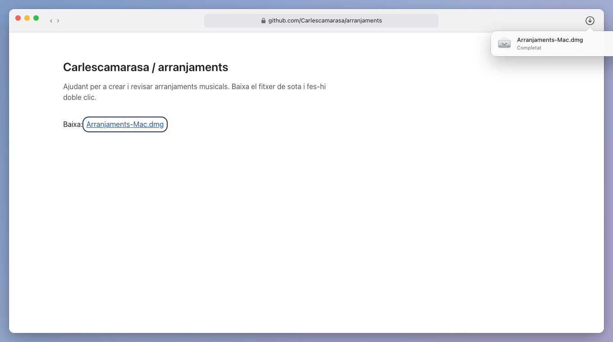

2. Fes doble clic al DMG (a la carpeta Descàrregues). S'obri una finestra amb «Instal·lar Arranjaments» (la icona del pentagrama): fes-hi doble clic, sense arrossegar-la enlloc.

   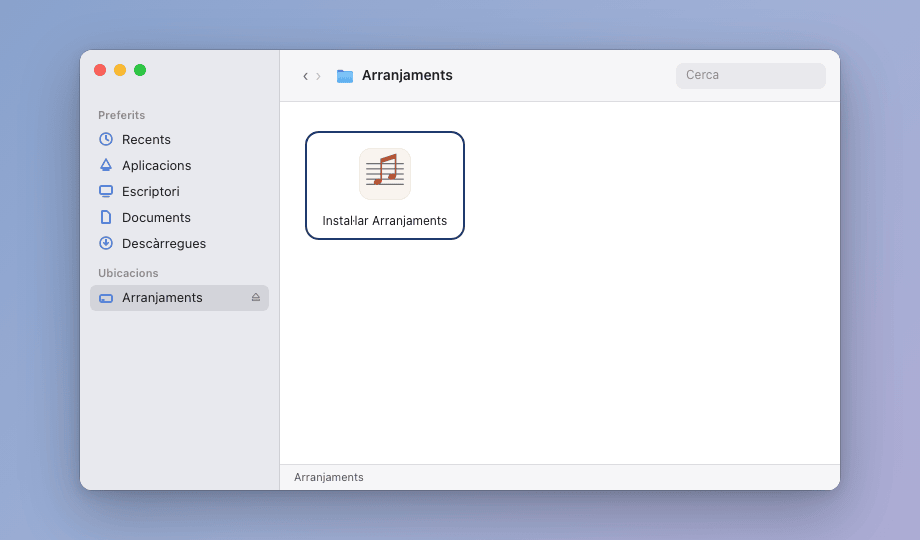

3. La primera vegada, el Mac avisa que no ha pogut verificar l'aplicació. Prem «Fet». No la mogues a la paperera.

   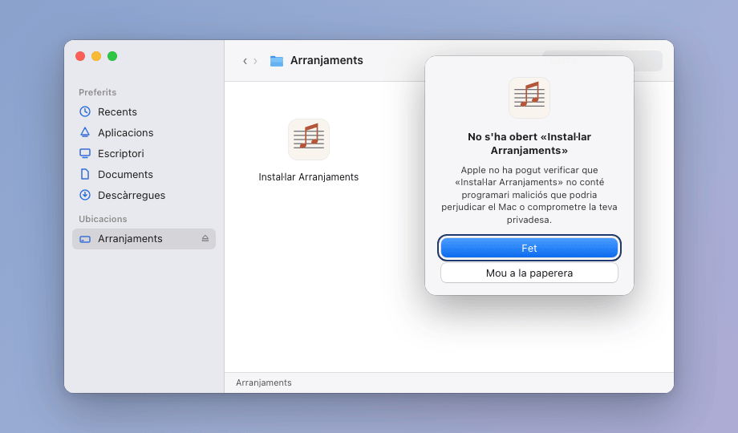

4. Obri «Configuració del Sistema», «Privacitat i seguretat», baixa fins a «Seguretat» i prem «Obre de tota manera». Et demanarà la contrasenya de l'ordinador.

   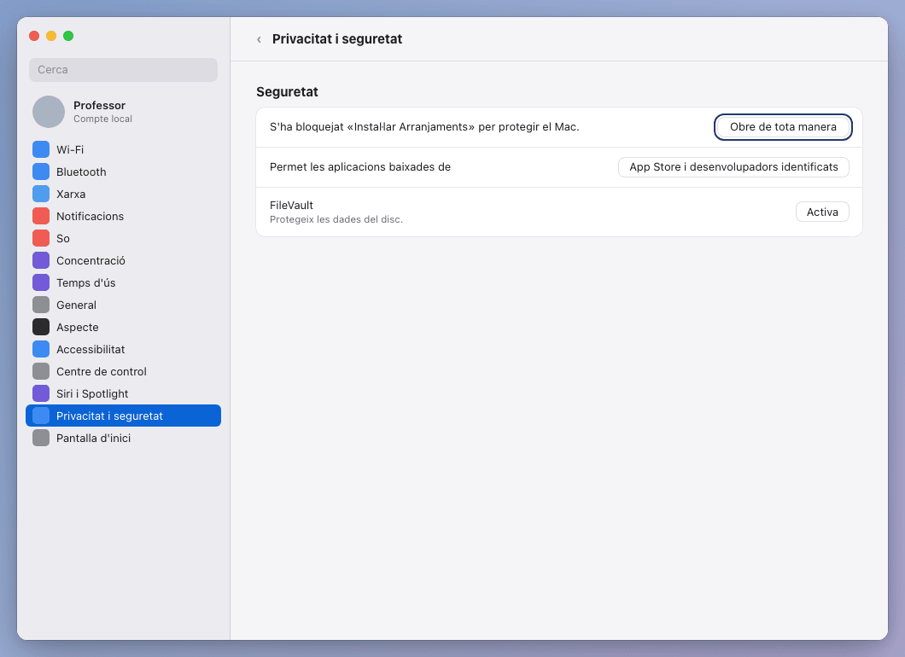

5. S'obri l'instal·lador. Prem «Instal·lar» i espera: cada pas es marca quan acaba.

   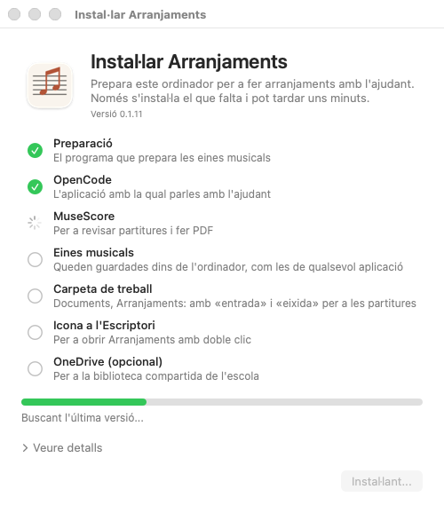

6. Quan diu «Tot a punt», ja està instal·lat.

   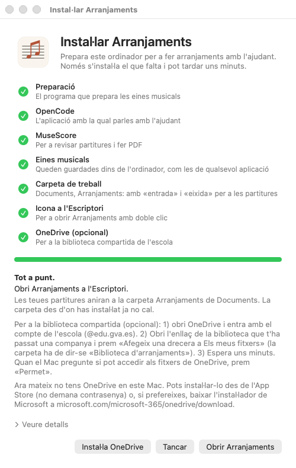

7. Fes doble clic a la icona «Arranjaments» de l'Escriptori.

   

8. S'obri OpenCode. La primera vegada, prem «Afegeix projecte».

   

9. Tria la carpeta `Arranjaments` de Documents i prem «Obre».

   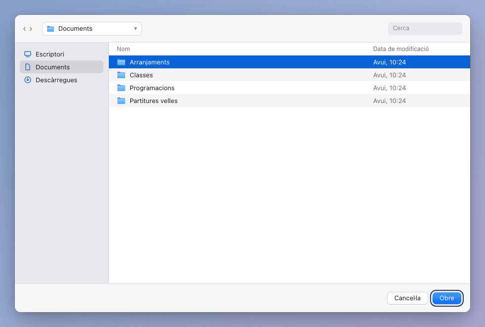

10. Crea una sessió nova, escriu el que vols amb paraules normals i envia-ho.

   

11. L'ajudant treballa i et fa preguntes d'una en una. Tria una resposta i prem «Envia».

   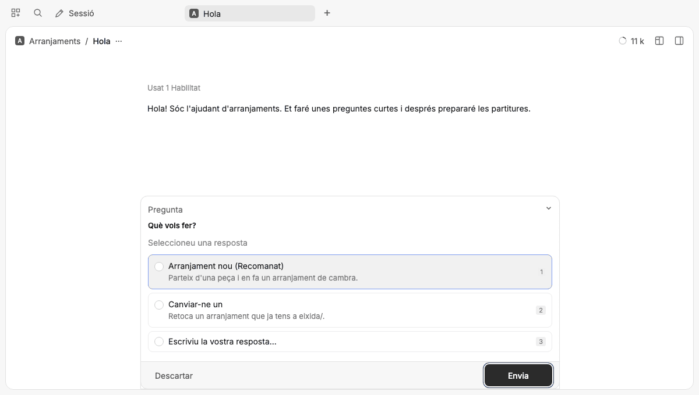

12. Quan acaba, et diu què ha fet i on són els fitxers.

   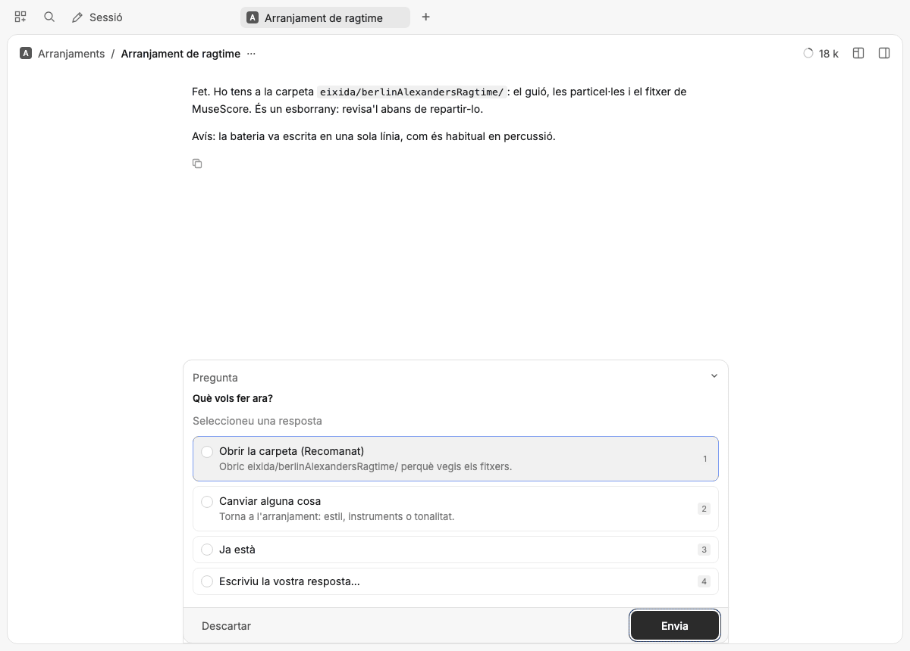

13. Els PDF són a Documents, `Arranjaments`, `eixida`.

   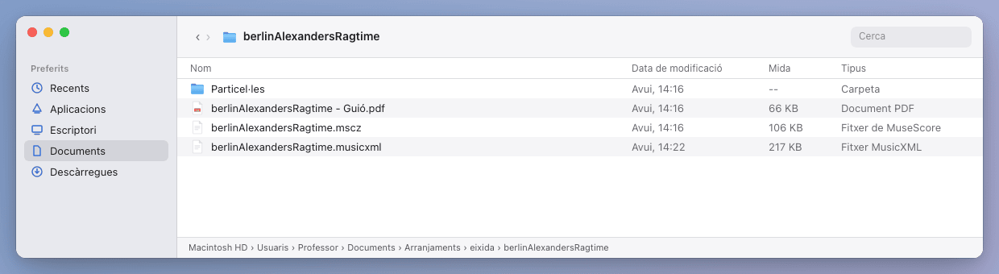

14. Si un model deixa de contestar, prem el nom del model (o escriu `/models`) i tria'n un altre de gratuït.

   

<strong>Windows</strong>

1. Baixa `Arranjaments-Windows.exe` des de l'enllaç de dalt.

   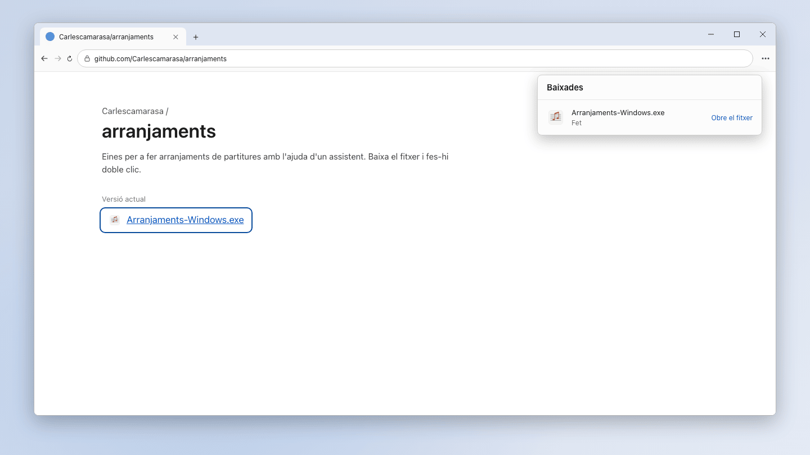

2. A la carpeta Baixades, fes doble clic a `Arranjaments-Windows.exe` (no cal descomprimir res).

   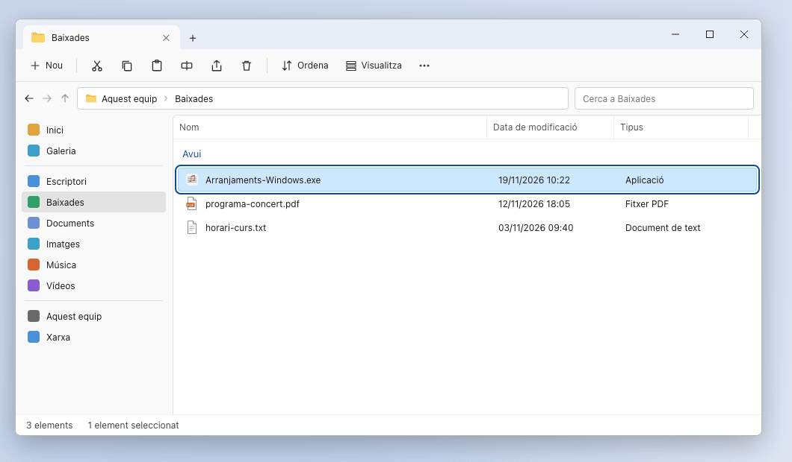

3. Si apareix la finestra blava «Windows ha protegit el teu PC», prem «Més informació» i després «Executa igualment».

   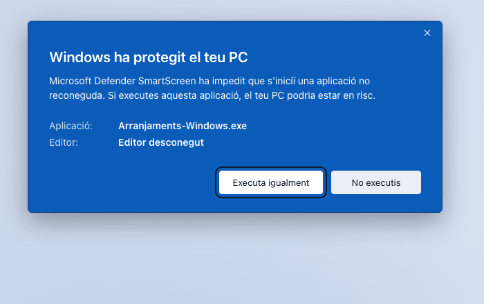

4. S'obri l'instal·lador. Prem «Instal·lar» i espera: cada pas es marca quan acaba. Si MuseScore demana permís (finestra blava), prem «Sí».

   

5. Quan diu «Tot a punt», ja està instal·lat.

   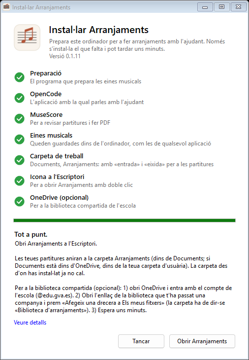

6. Fes doble clic a la icona «Arranjaments» de l'Escriptori.

   

7. S'obri OpenCode. La primera vegada, prem «Afegeix projecte».

   

8. Tria la carpeta `Arranjaments` de Documents i prem «Selecciona una carpeta».

   

9. Crea una sessió nova, escriu el que vols amb paraules normals i envia-ho.

   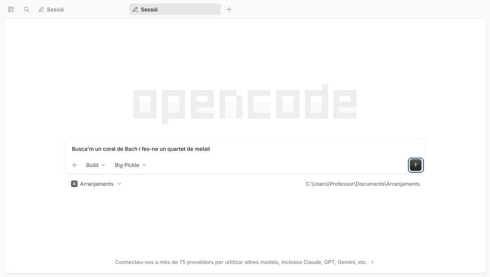

10. L'ajudant treballa i et fa preguntes d'una en una. Tria una resposta i prem «Envia».

   

11. Quan acaba, et diu què ha fet i on són els fitxers.

   

12. Els PDF són a Documents, `Arranjaments`, `eixida`.

   

13. Si un model deixa de contestar, prem el nom del model (o escriu `/models`) i tria'n un altre de gratuït.

   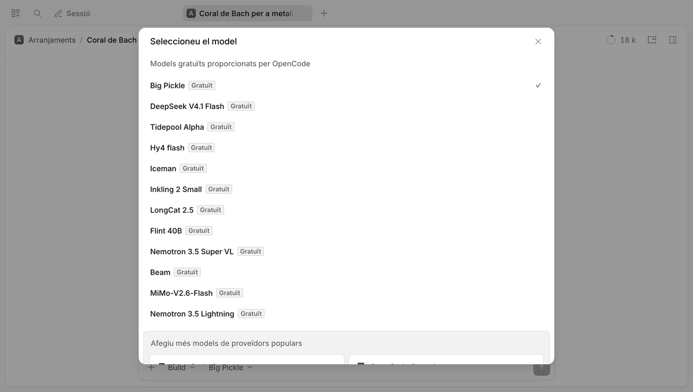

## LliureX i altres Linux (Ubuntu)

Sense finestra bonica, però amb la mateixa instal·lació i **sense contrasenya d'administradora**. Està pensat per a LliureX 23 (Ubuntu 22.04) i LliureX 25 (Ubuntu 24.04), tots dos amb l'escriptori KDE Plasma, i es prova automàticament en Ubuntu 22.04 i 24.04 nets (Intel/AMD) i 24.04 ARM, no en un LliureX de veritat. En ARM cal Ubuntu 24.04 o més nou (LliureX 25): el MuseScore per a ARM no funciona en 22.04. Només per a ordinadors de 64 bits.

1. Baixa **[Arranjaments-LliureX.run](https://github.com/Carlescamarasa/arranjaments/releases/latest/download/Arranjaments-LliureX.run)**. És un sol fitxer: porta el projecte a dins.
2. **Dona-li permís d'execució.** Els navegadors baixen els fitxers sense este permís, i sense ell el doble clic només l'obri com a text. Al gestor de fitxers (Dolphin): clic dret al fitxer, «Propietats», pestanya «Permisos», marca **«És executable»** (en castellà, «Es ejecutable») i «D'acord».
3. Fes-hi doble clic. Dolphin et pregunta si vols executar-lo: tria **«Executar»**. S'obri sola una finestra de Terminal amb el progrés (és normal) i, quan acaba, diu «Tot a punt». Tarda uns minuts (baixa OpenCode i MuseScore).
4. Obri la icona **«Arranjaments»** de l'Escriptori (o del menú d'aplicacions), i després com al pas 3 de dalt: «Afegeix projecte» i tria la carpeta `Arranjaments` de Documents.

**Si no vols tocar permisos, o el doble clic no fa res:** obri la carpeta amb el gestor de fitxers, prem **F4** (s'obri un terminal a baix, ja dins de la carpeta) i escriu `sh Arranjaments-LliureX.run`. Fa exactament el mateix i no necessita cap permís. Si el fitxer s'obri en un editor de text, és que falta el permís del pas 2.

- No cal `libfuse2` ni res d'administradora: les aplicacions (AppImage) es descomprimeixen una vegada dins de `~/.local/share/Arranjaments`.
- Documents i Escriptori són els del sistema (poden dir-se «Documentos» o «Escritorio»).
- Audiveris (només per a convertir PDF) a Linux s'instal·la a mà amb el paquet `.deb` de [la seua pàgina](https://github.com/Audiveris/audiveris/releases), cosa que necessita una administradora.
- **En ordinadors d'un centre**, l'administració pot tindre bloquejat baixar o executar programes de la carpeta personal, i llavors la instal·lació pot fallar. Si passa, consulta-ho amb qui l'administra (el mateix text de l'instal·lador diu què ha fallat).
- Per a desinstal·lar: esborra `~/.local/share/Arranjaments`, `~/.local/bin/partitures`, `arranjaments.desktop` del menú d'aplicacions i de l'Escriptori.

### Si el Mac o el Windows no deixa obrir l'instal·lador

És normal: «Instal·lar Arranjaments» és un programa baixat d'internet i no està signat per cap empresa (signar-lo costa diners cada any), i els sistemes avisen amb tots els programes així. El codi és públic en este mateix lloc (carpeta `instalacio/`) i només instal·la el que s'ha descrit ací. Els noms dels botons canvien segons l'idioma de l'ordinador: ací van en valencià i en castellà.

**Mac** (macOS 15 Sequoia o més nou):

1. Fes doble clic a `Instal·lar Arranjaments`. Apareix un avís que diu que Apple no ha pogut verificar l'aplicació. Prem «Fet» (en castellà, «Aceptar»). No la mogues a la paperera.
2. Menú Apple, «Configuració del Sistema» («Ajustes del Sistema»), «Privacitat i seguretat» («Privacidad y seguridad»).
3. Baixa fins a la secció «Seguretat». Hi veuràs que «Instal·lar Arranjaments» s'ha bloquejat: prem **«Obre de tota manera»** (en castellà, **«Abrir igualmente»**). El botó només apareix durant una hora, més o menys, després de l'intent del pas 1.
4. Escriu la contrasenya de l'ordinador (o usa Touch ID) i confirma.

Només cal fer-ho la primera vegada. Font: Apple, [Obrir una app que Apple no ha verificat](https://support.apple.com/ca-es/guide/mac-help/mh40617/mac).

**Windows** (10 i 11, també ARM):

- Si el navegador avisa que el fitxer no es baixa habitualment, tria «Conserva».
- Si apareix una finestra blava «Windows ha protegit el teu PC» (SmartScreen), prem **«Més informació»** i després **«Executa igualment»** (en castellà, «Más información» i «Ejecutar de todas formes»).
- Si Windows 11 diu que el **Control intel·ligent d'aplicacions** (Smart App Control) ha bloquejat el programa i no hi ha cap botó per a continuar, o si l'ordinador és d'un centre i no deixa: usa l'alternativa de més avall.

Fonts: Microsoft, [SmartScreen i els programes sense signar](https://learn.microsoft.com/windows/apps/package-and-deploy/smartscreen-reputation) i [com treure la marca d'internet (Mark of the Web) d'un fitxer](https://learn.microsoft.com/en-us/microsoft-365-apps/security/internet-macros-blocked#remove-mark-of-the-web-from-a-file).

**Alternativa sense finestra bonica.** Si «Instal·lar Arranjaments» no s'obri de cap manera, baixa [arranjaments.zip](https://github.com/Carlescamarasa/arranjaments/releases/latest/download/arranjaments.zip) (el projecte complet). Dins de la carpeta `instalacio` hi ha els instal·ladors de text, que fan exactament el mateix en una finestra negra: `Instalar-Mac.command` (Mac) i `Instalar-Windows.bat` (Windows). A Windows, **abans de descomprimir**, clic dret al ZIP, «Propietats», marca **«Desbloquejar»**, «Aplica» i «D'acord»; després, clic dret, «Extreure-ho tot». Doble clic a l'instal·lador i s'obri una finestra negra amb text: és normal. Al Mac, el primer avís es resol igual que en els passos de dalt.

## Frases que pots escriure

- «Busca'm un coral de Bach en format editable.» (Cerca en el corpus de música lliure que ja ve instal·lat; si l'obra no hi és, l'ajudant et proposa on buscar-la.)
- «Tinc un PDF a entrada/ i el vull convertir en partitura.»
- «Què hi ha dins d'entrada/coral.musicxml?»
- «Vull fer-ne un arranjament per a dues trompetes, trompa i trombó.»
- «Comprova si les notes els van bé a cada instrument.»
- «Passa la trompa una octava més amunt.»
- «Transporta-ho un to més avall.»
- «Obri-me la partitura amb MuseScore.»
- «Genera els PDF de la partitura i de les parts.»

L'ajudant et farà preguntes d'una en una. Contesta amb frases normals.

## Quan un model gratuït deixa de funcionar

Els models gratuïts van i vénen: un dia n'hi ha un que s'acaba, va molt lent o dona errors. No és culpa teua. Normalment OpenCode en tria un altre de sol. Si no ho fa, canvia'l tu:

1. A la zona on escrius, busca el nom del model i prem-lo per a veure la llista (o escriu `/models` i prem Retorn).
2. Tria un altre model de la llista (els gratuïts porten «free» en el nom, o són «Big Pickle»).
3. Torna a escriure la teua petició.

## Importants

- **Revisa sempre** el que ve d'un PDF: el reconeixement automàtic s'equivoca (alteracions, ritmes, lligadures). Obri el resultat amb MuseScore i comprova-ho compàs a compàs.
- Les **tessitures** (fins on pot tocar cada instrument) són orientatives, de manual. Tu coneixes els teus alumnes i el teu instrument: tu decideixes.
- Els **noms de les notes** són en solfeig i segueixen la convenció espanyola: el Do central és Do3 (en altres llocs, Do4 o C4).
- **Drets d'autor**: treballa amb música de domini públic o amb llicència que ho permeta. Una edició moderna d'una obra antiga pot tindre drets propis.
- Les eines **no canvien mai l'original ni sobreescriuen res**: sempre creen un fitxer nou a `eixida/` (si el nom ja existeix, afigen -2, -3...) i no escriuen fora de la carpeta de treball. L'última línia de cada ordre diu «Fitxer actual», el fitxer amb què continuar.

## Per a qui vol saber-ne més (no cal)

**Com funciona l'actualització (tècnic).** La icona executa primer `python -I -m partitures.actualitzar --silenci` (només biblioteca estàndard, sense music21) i després obri OpenCode; a Windows, la icona és un Python sense finestra (`pythonw`) que fa el mateix i obri OpenCode al final. L'actualitzador baixa `versio.json` (versió i sha256) de la versió «ultima» de GitHub amb un límit de 5 segons i, com a molt, una consulta per hora. Si hi ha una versió més nova, baixa `actualitzacio.zip` (només eines i configuració), comprova el sha256, ho descomprimeix a una carpeta temporal de la carpeta de dades, guarda la versió actual a `anterior/` i canvia les peces una a una (si una falla, torna tot enrere). Només renova `scripts`, `instalacio`, `pyproject.toml`, `uv.lock` (i fa `uv sync` només si ha canviat), `VERSION` i la configuració amagada `.opencode` de la carpeta de treball; mai `entrada/`, `eixida/` ni cap fitxer teu. Tot queda escrit a `actualitzacio.log` de la carpeta de dades. Ordres: `partitures versio`, `partitures actualitzar` i `partitures actualitzar --torna-enrere` (l'ajudant demana permís abans d'`actualitzar`). La versió és `major.menor` de `VERSION` més el número d'execució del CI.

**Seguretat de les actualitzacions.** Només es baixa de l'adreça fixa `https://github.com/Carlescamarasa/arranjaments/releases/latest/download/` (HTTPS, es rebutgen les redireccions que no ho siguen) i es comprova el sha256 del fitxer `versio.json`, que protegeix de baixades trencades però no d'un atac a GitHub: **qui controla el compte de GitHub del projecte controla les actualitzacions de tots els ordinadors**. Per això el compte ha de tindre verificació en dos passos (2FA) activada. La variable `ARRANJAMENTS_ACTUALITZACIO_URL` només serveix per a les proves.

On queda cada cosa després d'instal·lar:

| Què | Mac | Windows | Linux |
| --- | --- | --- | --- |
| Carpeta de treball (l'única visible) | `~/Documents/Arranjaments` | `Documents\Arranjaments` | `Documents/Arranjaments` (la del sistema) |
| Configuració de l'ajudant (amagada) | `.opencode` dins de la carpeta de treball | igual, amb l'atribut d'amagat | `.opencode` dins de la carpeta de treball |
| Eines musicals i el seu Python | `~/Library/Application Support/Arranjaments` | `%LOCALAPPDATA%\Arranjaments` | `~/.local/share/Arranjaments` |
| Ordre `partitures` | `~/.local/bin/partitures` | `%USERPROFILE%\.local\bin\partitures.cmd` | `~/.local/bin/partitures` |

- A Windows, Documents pot estar dins d'OneDrive: no passa res, allí només hi ha partitures. Les eines van a una carpeta que OneDrive no sincronitza.
- `.opencode/AGENTS.md` (dins de la carpeta de treball): les instruccions que llig l'ajudant. `.opencode/skills/`: les guies de procediment (buscar, importar PDF, arranjar, exportar i comprovar la instal·lació).
- `.opencode/opencode.json`: els permisos i el model per defecte (`opencode/big-pickle`, gratuït; si algun dia desapareix, OpenCode usa el model més nou disponible). Format de permisos d'OpenCode 2. Les ordres `partitures ...` s'executen sense preguntar, excepte `partitures instalar ...`, que pregunta; les ordres d'esborrar o moure fitxers (`rm`, `del`, `rmdir`, `Remove-Item`, `mv`...) estan bloquejades; qualsevol altra ordre pregunta primer, igual que baixar una pàgina web o accedir fora de la carpeta. L'ajudant no pot editar fitxers directament. Aquests permisos són una xarxa de seguretat, no una garantia: per això convé llegir el que et demana abans d'acceptar.
- L'ordre `partitures` treballa sempre sobre la carpeta des d'on s'executa: llig i escriu només a `entrada/` i `eixida/` d'eixa carpeta. `partitures --help` mostra totes les ordres; `partitures comprovar` diu què hi ha instal·lat; `partitures instalar audiveris` (o `musescore`) instal·la el que falta.
- Si Audiveris o MuseScore estan en un lloc inusual, pots indicar la ruta amb les variables d'entorn `AUDIVERIS_PATH` i `MUSESCORE_PATH`.
- Per a desinstal·lar: esborra la carpeta de les eines i el fitxer de l'ordre `partitures` (taula de dalt), la icona de l'Escriptori i, si vols, OpenCode i MuseScore. La carpeta de treball és teua: guarda-la o esborra-la.

En este repositori (per a qui vol canviar el programa):

- `AGENTS.md`, `opencode.json` i `.opencode/skills/`: el que l'instal·lador copia dins de `.opencode` a la carpeta de treball.
- `scripts/partitures/`: les eines musicals (Python + music21). Dins del repositori s'executen amb `uv run partitures ...`.
- `instalacio/`: els instal·ladors de veritat (`instalar-mac.sh`, `instalar-windows.ps1` i `instalar-linux.sh`). «Instal·lar Arranjaments» és només una finestra que executa estos mateixos fitxers i en mostra el progrés; el seu codi és a `instalacio/visual/` (Swift per a Mac, C# per a Windows) i es construeix sol a GitHub cada vegada que canvia el projecte. Els fitxers que baixa la professora es fan també allà (`instalacio/visual/paquets.py`, `mac/fes-dmg.sh` i `linux/capcalera.sh`): cadascun és l'instal·lador amb el projecte a dins (`Arranjaments-Windows.exe`: el programa amb un ZIP enganxat al final; `Arranjaments-Mac.dmg`: l'aplicació amb `Contents/Resources/projecte.tar.gz`; `Arranjaments-LliureX.run`: un guió amb un tar.gz enganxat). En obrir-se, el programa descomprimeix el projecte a una carpeta temporal (`staging`, dins de la carpeta de dades), executa el guió d'instal·lació i l'esborra en acabar. Es publiquen a «Releases» amb noms fixos, juntament amb `arranjaments.zip`, només quan la instal·lació ha anat bé en un Mac Apple Silicon, un Mac Intel, un Windows x64, un Windows ARM64 i tres Linux (22.04 x64, 24.04 x64 i 24.04 ARM64). Es poden usar a mà, per separat si vols: `bash "instalacio/instalar-mac.sh" --nomes uv` (o `opencode`, `musescore`, `eines`, `carpeta`, `icona`; `audiveris` només si cal convertir PDF); Windows: `powershell -ExecutionPolicy Bypass -File "instalacio\instalar-windows.ps1" -Nomes uv`. Amb `--prova` (Windows `-Prova`) només comprova. No cal Homebrew. Audiveris porta Java inclòs.
- **Arquitectures.** Mac: l'aplicació és universal (Apple Silicon i Intel) i els guions trien sols la versió d'OpenCode (`arm64` o `x64`) i d'Audiveris. Windows: el programa és AnyCPU, així que a Windows ARM corre de forma nativa; el guió pregunta l'arquitectura al sistema (no al procés, que en emulació pot mentir) i instal·la OpenCode ARM64 si és un ARM. MuseScore i Audiveris només tenen versió x64 per a Windows: en un Windows 11 ARM funcionen per emulació. `uv` i Python s'instal·len nadius (ARM64) i la icona «Arranjaments» usa el Python de l'entorn de les eines, que és el seu. Linux: OpenCode i MuseScore tenen AppImage `arm64`/`aarch64`, i s'escull per `uname -m`. Audiveris a Linux no s'instal·la sol.
- Proves: `uv run pytest` (a GitHub també s'executen a Mac i a Windows, amb una instal·lació de veritat en ordinadors nets, i la instal·lació de Linux es prova en Ubuntu 22.04 i 24.04).
- Alternativa amb línia d'ordres (Terminal): `curl -fsSL https://opencode.ai/v2/install | bash`, i després `opencode` dins de la carpeta de treball. El format de `opencode.json` és el d'OpenCode 2; amb OpenCode 1 caldria el format antic (`permission`).

## Instal·lació manual (si l'instal·lador automàtic no funciona)

1. **OpenCode.** Mac: [per a Mac amb xip Apple (M1, M2, M3...)](https://opencode.ai/update/api/latest/desktop/opencode/opencode-desktop-mac-arm64.dmg) o [per a Mac amb Intel](https://opencode.ai/update/api/latest/desktop/opencode/opencode-desktop-mac-x64.dmg); obri el fitxer i arrossega OpenCode a Aplicacions (si no saps quin Mac tens: menú Apple, «Sobre este Mac»). Windows: [descarrega per a Windows](https://opencode.ai/update/api/latest/desktop/opencode/opencode-desktop-win-x64.exe) (o, si l'ordinador és ARM, la [versió ARM64](https://opencode.ai/update/api/latest/desktop/opencode/opencode-desktop-win-arm64.exe)) i fes-hi doble clic. Totes les opcions: https://opencode.ai/download
2. **MuseScore** (gratuït; potser ja el tens): https://musescore.org/ca/download. Tria l'opció «sense MuseHub» (MuseScore Studio «without MuseHub»), que és l'aplicació sola.
3. **Linux:** OpenCode, «Linux (AppImage)» a https://opencode.ai/download, i MuseScore, l'AppImage de https://musescore.org/ca/download. Per a les eines i la carpeta: `bash "instalacio/instalar-linux.sh" --nomes eines` i `--nomes carpeta` (cal [uv](https://docs.astral.sh/uv/getting-started/installation/)).
4. **Les eines musicals i la carpeta de treball (Mac i Windows):** instal·la [uv](https://docs.astral.sh/uv/getting-started/installation/) i després executa l'instal·lador només per a estes dues coses. Mac: `bash "instalacio/instalar-mac.sh" --nomes eines` i `bash "instalacio/instalar-mac.sh" --nomes carpeta`. Windows: `powershell -ExecutionPolicy Bypass -File "instalacio\instalar-windows.ps1" -Nomes eines` i el mateix amb `-Nomes carpeta`.
5. Obri OpenCode, tria «Afegeix projecte» i selecciona la carpeta `Arranjaments` de Documents.

## Llicència

MIT: es pot usar, copiar i adaptar lliurement, també en altres conservatoris. Vegeu `LICENSE`.
